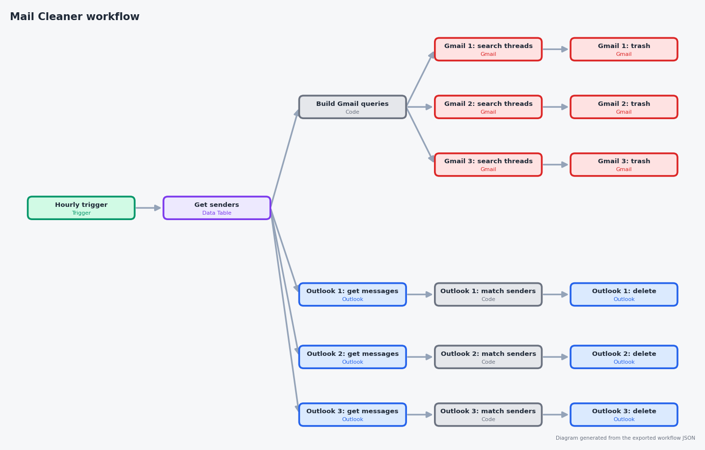
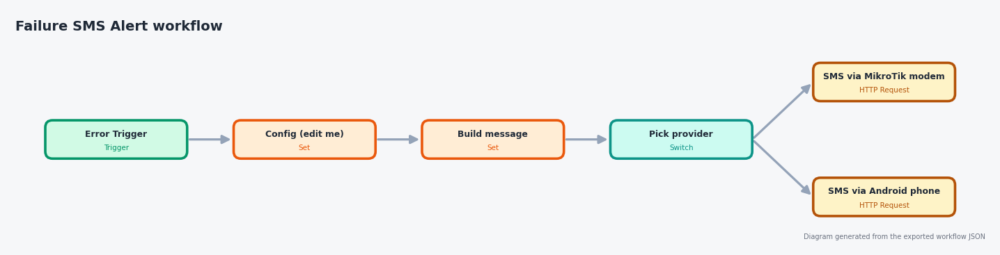

# Homelab Mail Cleaner

A self-hosted, always-on inbox cleaner built with **n8n** and run on a home NAS.
It clears unwanted mail from a single, central sender list across many
mailboxes (Gmail and Microsoft 365 / Outlook), and sends an **SMS when a run
fails**. SMS goes through hardware you already have at home, with no chat apps
and no paid gateway.

> **Note:** this workflow may seem a bit redundant, but it's just a homelab where an average person tries to figure out what automation is.

## Features

- **One sender list, every mailbox.** A single n8n Data Table (`senders`)
  drives the cleanup for all accounts. Edit the list once, and every mailbox
  picks it up on the next run.
- **Multi-account.** The example workflow covers 3 Gmail accounts and 3
  Microsoft 365 mailboxes. Adding another is a copy-paste of one branch.
- **Recoverable.** Gmail threads are moved to Trash, and Outlook messages are
  deleted through the Outlook node (normally landing in Deleted Items). Test on
  a single sender first to confirm this on your own mailbox.
- **Safety filters on Gmail.** Starred, important, and sent mail is never
  touched.
- **Pluggable SMS alerts.** A failure alert workflow with a one-field switch
  between SMS providers (see below).
- **Runs unattended** on a NAS under Docker (Portainer stack).

## Architecture

More detail: [docs/architecture.md](docs/architecture.md).

## The workflows

**Mail Cleaner** runs hourly: it reads the `senders` table, then cleans each
Gmail and Outlook mailbox in its own branch.

**Failure SMS Alert** runs whenever another workflow errors out, and sends one
short SMS through the provider you pick.

## SMS providers

The alert workflow has a **Config** node with a `provider` field:

| Provider | What sends the SMS | Needs |
| --- | --- | --- |
| `routeros` | A MikroTik LTE/5G modem's SIM, via the RouterOS REST API | A RouterOS device with a SIM and REST enabled |
| `android` | Any spare Android phone on your Wi-Fi, running an SMS gateway app | A phone with a SIM and the app's local server turned on |

Adding another provider means adding one Switch branch and one HTTP Request
node. Details and setup: [docs/sms-providers.md](docs/sms-providers.md).

## Repo layout

| Path | What it is |
| --- | --- |
| `workflows/mail-cleaner.json` | The cleanup workflow (credentials removed) |
| `workflows/failure-sms-alert.json` | The error workflow with the provider switch |
| `docker/` | n8n compose file (host network mode) and `.env.example` |
| `docs/senders-table.md` | Schema and matching rules for the `senders` table |
| `docs/setup.md` | Step-by-step setup |
| `docs/sms-providers.md` | Configuring each SMS provider |
| `docs/images/` | Diagrams used in the docs, plus `social-preview.png` for the repo's social card |

## Quick start

1. Copy `docker/.env.example` to `docker/.env` and set a strong
   `N8N_ENCRYPTION_KEY`, then run `docker compose up -d`.
2. Follow [docs/setup.md](docs/setup.md): create OAuth credentials, create the
   `senders` table, import both workflows, and re-link your credentials.

## Known limitations

- Each Gmail search returns up to 250 threads per batch of 40 senders per run.
  A large backlog clears over several runs.
- The Outlook branches list every message in the mailbox each run, which gets
  slow on large mailboxes. Filtering by folder or received date would help.
- A traditional landline cannot send SMS. The `android` provider covers the
  "ordinary phone at home" case.

## Security notes

- No credentials, tokens, phone numbers, or sender lists are in this repo.
  Workflow exports have credential references removed; re-link your own.
- Keep `N8N_ENCRYPTION_KEY` safe. Losing it makes saved credentials unreadable.
- OAuth apps use your own Google Cloud project and Entra tenant.

## Lessons learned

- On many NAS Docker setups the default bridge network has no internet access.
  `network_mode: host` fixed it.
- A central sender table plus recoverable deletes makes automated cleanup
  low-risk and easy to maintain.

## License

MIT, see [LICENSE](LICENSE).
