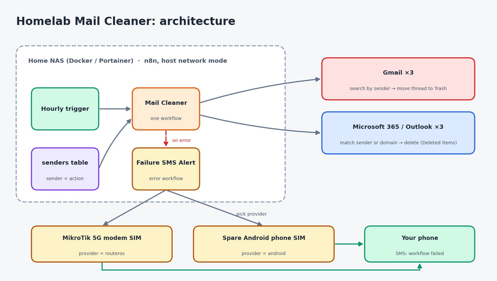

# Architecture

## Hardware

- **NAS:** Asustor AS5402T (12 GB RAM) running Docker via Portainer.
- **Uplink:** MikroTik ATL 5G R16 5G CPE feeding a UniFi gateway, with a
  fixed-wireless/airfiber link as failover.
- **SMS:** alerts go out through a SIM already at home: the 5G modem's own SIM
  (RouterOS) or a spare Android phone running an SMS gateway app. No external
  SMS gateway or chat app is needed.

## Data flow

1. A schedule trigger starts each cleanup workflow.
2. The workflow reads the central `senders` Data Table.
3. Gmail: one search query per batch of 40 senders, then each matching thread is
   moved to Trash. Outlook: all messages are listed, matched against addresses
   and domains, then deleted (normally into Deleted Items).
4. Any failure triggers the error workflow, which sends an SMS through the
   configured provider.

## Design decisions

| Decision | Reason |
| --- | --- |
| Move to Trash, no permanent-delete step | Recoverable if a sender is added by mistake |
| Single shared sender table | Add a sender once, applies to every mailbox |
| SMS for failures only | Quiet by default, loud when it matters |
| Own OAuth apps | No third-party access to mailboxes |
